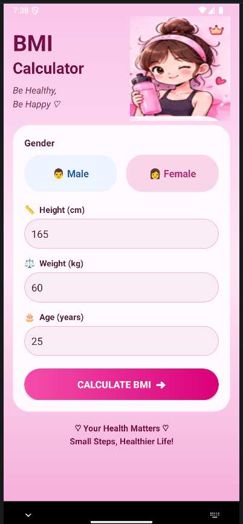

# 💗 BMI Calculator

A simple and user-friendly **BMI (Body Mass Index) Calculator Android Application** developed using **Kotlin and XML** in Android Studio. This application calculates BMI based on the user's height and weight and displays the corresponding BMI category.


---

## 📌 Project Overview

The BMI Calculator is an Android application designed to help users calculate their Body Mass Index (BMI) easily. Users can enter their gender, height, weight, and age. The application calculates BMI and displays the result along with the corresponding health category.

The application provides a simple interface with input validation and an option to calculate BMI again.

---

## ✨ Key Features

- **Gender Selection** – Select Male or Female.
- **Height Input** – Enter height in centimeters.
- **Weight Input** – Enter weight in kilograms.
- **Age Input** – Enter age in years.
- **BMI Calculation** – Automatically calculates BMI using height and weight.
- **BMI Result** – Displays the calculated BMI value and category.
- **Calculate Again** – Allows users to return to the calculator screen and calculate again.
- **Input Validation** – Checks whether the required input fields are entered correctly.
- **User-Friendly Interface** – Simple and attractive pink-themed design.

---

## 🛠️ Technologies Used

| Technology | Purpose |
|---|---|
| Kotlin | Application logic and BMI calculation |
| XML | Designing the application user interface |
| Android Studio | Development environment |
| Android SDK | Android application development |
| Gradle | Build and dependency management |

---

## 🧮 Calculation Approach

The application calculates BMI using the following formula:

**BMI = Weight (kg) / Height (m)²**

### Example

- Height: 170 cm = 1.70 m
- Weight: 65 kg

BMI = 65 / (1.70 × 1.70)

**BMI = 22.49**

The calculated BMI value is displayed along with its corresponding category.

---

## 🔄 System Workflow

```text
        Start Application
               |
               v
       BMI Calculator Screen
               |
               v
     Enter User Information
   (Gender, Height, Weight, Age)
               |
               v
        Validate Inputs
               |
        +------+------+
        |             |
     Invalid        Valid
        |             |
        v             v
 Display Error    Calculate BMI
                      |
                      v
                Result Screen
                      |
                      v
                Calculate Again
                      |
                      v
             BMI Calculator Screen
```

---

## 📱 Application Pages

### 1. BMI Calculator Screen
- Gender selection
- Height input
- Weight input
- Age input
- Calculate BMI button

### 2. BMI Result Screen
- Displays calculated BMI value
- Displays BMI category
- Provides Calculate Again option

---

## 📸 Screenshots

### BMI Calculator Screen



### BMI Result Screen


> Replace the screenshot filenames above with the actual screenshots of your application.

---

## 📂 Project Structure

```text
BMICalculator/
│
├── app/
│   └── src/
│       └── main/
│           ├── java/com/example/bmicalculator/
│           │   ├── MainActivity.kt
│           │   └── ResultActivity.kt
│           │
│           ├── res/
│           │   ├── drawable/
│           │   │   ├── bg_gradient.xml
│           │   │   ├── card_bg.xml
│           │   │   ├── input_bg.xml
│           │   │   ├── button_pink.xml
│           │   │   ├── button_small.xml
│           │   │   ├── male_card.xml
│           │   │   ├── female_card.xml
│           │   │   └── fitness_girl.png
│           │   │
│           │   └── layout/
│           │       ├── activity_main.xml
│           │       └── activity_result.xml
│           │
│           └── AndroidManifest.xml
│
└── README.md
```

---

## ⚙️ Installation

1. Clone the repository:

   ```bash
   git clone <your-repository-url>
   ```

2. Open Android Studio.

3. Select **Open** and choose the cloned project folder.

4. Wait for Gradle Sync to complete.

---

## ▶️ How to Run

1. Open the project in Android Studio.
2. Start an Android Emulator or connect an Android device.
3. Click the **Run ▶️** button.
4. Enter gender, height, weight, and age.
5. Click **Calculate BMI**.
6. View the calculated BMI and category.
7. Click **Calculate Again** to perform another calculation.

---

## 🧪 Testing

| Test Case | Expected Result | Status |
|---|---|---|
| Enter valid height and weight | BMI is calculated correctly | Passed |
| Enter empty input fields | Validation message is displayed | Passed |
| Select gender | Selected gender is accepted | Passed |
| Click Calculate BMI | Result screen opens | Passed |
| Click Calculate Again | Returns to calculator screen | Passed |

---

## 🚀 Future Enhancements

- BMI history tracking
- BMI result sharing
- Improved health recommendations
- Additional UI customization
- Support for more BMI-related information

---

## 🎯 Project Objectives

- To develop a simple Android application using Kotlin.
- To understand XML-based UI design.
- To implement BMI calculation logic.
- To understand Activity navigation.
- To implement input validation.
- To gain practical experience in Android application development.

---

## ⚠️ Disclaimer

BMI is a general screening measurement and does not provide a complete assessment of an individual's health. The results are intended for informational and educational purposes only.

---

## 👩‍💻 Author

**K.Rojasri**

Developed as an Android application development project using Kotlin and XML.

---

⭐ If you find this project useful, consider giving it a star on GitHub.
